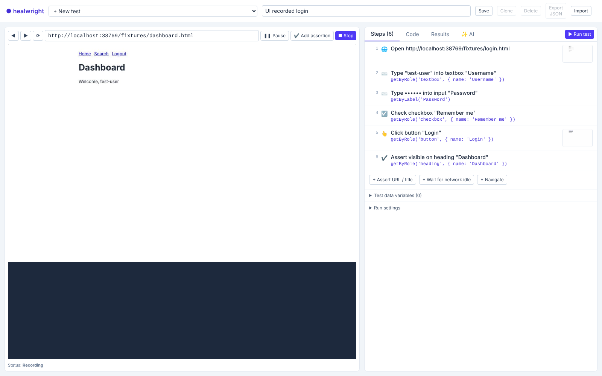

# healwright

healwright is a record-and-play test studio built on Playwright. You open the studio, record real interactions in a live remote Chromium, review and edit the captured steps, read the generated Playwright test, and replay it with step-by-step results. Optional Claude integration heals broken locators during replay and edits tests from plain-English instructions, always behind a reviewable diff.

> Proof of concept: see the known limitations in [docs/ARCHITECTURE.md](docs/ARCHITECTURE.md).

**Highlights**
- Real browser recording: input is forwarded to a remote Chromium, and each step stores ranked locators (test id → role → label → placeholder → text → CSS → XPath), verified by Playwright at record time.
- Engine-neutral action model, with a Playwright code generator and a replay engine (fallback locators, screenshots, per-step logs, replay from any step).
- AI self-healing and prompt-driven editing with Claude (optional, needs an API key).
- 38 automated tests across 20 recording/replay scenarios, generated-spec runs, UI end-to-end and AI flows.



- **Feature status, architecture, sequence diagram, roadmap, limitations:** [docs/ARCHITECTURE.md](docs/ARCHITECTURE.md)
- **Measured results from the last test run:** [docs/TEST_RESULTS.md](docs/TEST_RESULTS.md)
- **PostgreSQL schema (target design):** [docs/schema.sql](docs/schema.sql)

## How to run (step by step)

No programming knowledge is needed. You type a few commands into a text window called a **terminal**, and then use the studio in your normal web browser. Setup takes about 10 minutes the first time, mostly waiting for downloads.

### Step 1. Install Node.js (one time)

Node.js is the free program that runs healwright.

1. Go to **https://nodejs.org** and click the big green button for the **LTS** version (version 22 or newer).
2. Open the file you downloaded and click **Next / Continue** until it finishes. Keep all the default options.

### Step 2. Download healwright (one time)

1. Sign in to GitHub and open **https://github.com/abhishekbhardwajab/healwright**. The repository is private, so you need to have been given access.
2. Click the green **Code** button, then **Download ZIP**.
3. Unzip it: on Windows right-click the file and choose **Extract All**; on a Mac double-click it.
4. Move the unzipped folder somewhere easy to find, such as your **Documents** folder. It will be called something like `healwright-main`.

### Step 3. Open a terminal inside the healwright folder

**Windows**
1. Open the `healwright-main` folder in File Explorer.
2. Click once in the address bar at the top (where the folder path is shown), type `powershell`, and press **Enter**. A blue or black window opens: that is the terminal.

**Mac**
1. Open **Terminal** (press **Cmd + Space**, type `Terminal`, press **Enter**).
2. Type `cd ` (the letters c and d, then a space), drag the `healwright-main` folder from Finder into the Terminal window, and press **Enter**.

To check you are in the right place, type `npm -v` and press **Enter**. You should see a version number such as `10.9.0`. If you see an error instead, see *Troubleshooting* below.

### Step 4. Set up healwright (one time)

Type this command and press **Enter**:

```
npm run setup
```

This downloads everything healwright needs, including its own copy of the Chromium browser, and prepares the app. It can take 5 to 10 minutes. It is finished when you can type in the terminal again. Some yellow `WARN` lines are normal; only a red `ERR!` means something went wrong.

### Step 5. Start healwright

Type this command and press **Enter**:

```
npm start
```

When you see `healwright studio on http://localhost:3000`, open your web browser (Chrome, Edge, Safari or Firefox) and go to:

**http://localhost:3000**

Leave the terminal window open while you use the studio. Closing it stops healwright.

### Step 6 (optional). Turn on the AI features

The AI self-healing and "change this test by asking" features use Claude and need an **Anthropic API key**. Everything else works without one.

1. Create a key at **https://console.anthropic.com** (an Anthropic account with billing is required; each AI request is a small paid API call).
2. Stop healwright if it is running (click the terminal and press **Ctrl + C**).
3. In the same terminal, set the key and start again. Replace `your-key-here` with your key, keeping the quotes:

   **Windows (PowerShell)**
   ```
   $env:ANTHROPIC_API_KEY="your-key-here"
   npm start
   ```

   **Mac**
   ```
   export ANTHROPIC_API_KEY="your-key-here"
   npm start
   ```

The **✨ AI** tab in the studio shows the model name when the key was picked up. You need to set the key again each time you open a new terminal window. Keep the key private: never share it or save it inside the project folder.

### Every time after that

You only repeat Steps 3 and 5: open a terminal in the healwright folder and type `npm start` (plus the Step 6 key line first if you want the AI features). Then go to http://localhost:3000.

**To stop healwright:** click the terminal window and press **Ctrl + C** (on a Mac too), or just close the window.

### Troubleshooting

| What you see | What to do |
|---|---|
| `npm is not recognized` / `command not found: npm` | Node.js is not installed, or the terminal was opened before installing it. Install Node.js (Step 1), close the terminal, and open a new one. |
| Windows: `running scripts is disabled on this system` | Type `npm.cmd run setup` and `npm.cmd start` instead, or run this once and answer **Y**: `Set-ExecutionPolicy -Scope CurrentUser RemoteSigned` |
| `ENOENT: no such file or directory, open ... package.json` | The terminal is not inside the healwright folder. Redo Step 3. |
| `EADDRINUSE` or "port 3000 is already in use" | healwright (or another program) is already running. Close other terminal windows running it, or start on another port: Windows `$env:PORT="3001"; npm start`, Mac `PORT=3001 npm start`, then open http://localhost:3001 |
| The browser says "This site can't be reached" | healwright is not running. Check the terminal shows `healwright studio on http://localhost:3000` and has not been closed. |
| The page opens but is blank | The setup did not finish. Run `npm run setup` again and watch for red `ERR!` lines. |
| `Executable doesn't exist` or a message about installing browsers | The Chromium download did not finish. Run `npx playwright install chromium`. On a company network, a firewall may block it; ask your IT team. |
| The ✨ AI tab says AI is not configured | The API key was not set in the same terminal window before `npm start`. Redo Step 6. |
| Anything else | Copy the red text from the terminal and send it to the project owner. |

## Using the studio

The URL box defaults to the bundled demo site (`/fixtures/login.html`, user `test-user` / password `s3cret!`); any public URL also works. Then:

1. Press **● Record**. A Chromium session opens in the live view.
2. Click and type in the live view. Steps appear on the right as you go.
3. Press **✔ Add assertion** and click an element to check visibility, text, value, and so on.
4. Press **■ Stop**. The test is saved.
5. Open **Code** to see, copy or download the Playwright spec.
6. Press **▶ Run test**. Results show each step's status, duration, screenshot, any healed locator, and logs.

Hover a step to edit, delete, duplicate, reorder, disable, add an assertion on its element, replay that step, or replay from it.

### Live browser window

Tick **Live window** next to **● Record** to record in a real Chromium window on your computer instead of the in-studio view. Enter any website URL, press Record, and use the window like a normal browser:

- Clicks, typing, dropdowns (the browser's own), checkboxes, drag and drop, keyboard shortcuts and scrolling are recorded as usual.
- Typing a URL in the window's address bar, the Back, Forward and Reload buttons, and switching tabs are recorded too (a tab switch is recorded when you first click or type in the other tab).
- File uploads: when the page asks for a file, the studio shows the file picker, so the same file can be reused when the test runs.
- **✔ Add assertion** works in the window: press it in the studio, then click the element in the window.
- The studio view mirrors the window. If you close the window, the steps are kept: press **■ Stop** to save, or enter a URL to open the window again.

To watch a replay, open **Run settings** and tick **Run in a live browser window**. **Pause between steps** slows it down so you can follow along.

Live mode needs a screen: it works when the studio runs on your own Mac, Windows or Linux desktop. On a Linux server without a display, start the studio with `xvfb-run npm start` (the window is then virtual). In Docker the option is greyed out.

### AI self-healing and prompt editing (Claude)

Set `ANTHROPIC_API_KEY` before `npm start` to turn on two features. Without a key both are off and the rest of the studio works as before.

- **Self-healing.** When every recorded locator for a step fails during a run, the studio sends Claude a snapshot of the page's interactive elements plus what was recorded about the element (role, name, text, old locators). If Claude picks an element with at least 70% confidence, the studio builds fresh locators for it, checks they match exactly that one element, and carries on. The Results panel then lists the fix (old vs new locator, confidence, reasoning) with **Accept** / **Reject** / **Accept all**. Accepting rewrites the step's locators and the generated code. Run settings → *AI self-healing* switches between *suggest* (default), *auto* (save fixes without review) and *off*.
- **Prompt editing.** Open the **✨ AI** tab, describe the change ("use a variable for the username, drop the Remember me step, check the heading says Welcome"), and press **Propose change**. Claude returns step operations; the studio validates them and shows a code diff. Nothing is saved until you press **Accept change**. If you are recording, Claude also sees the elements on the live page.


### Configuration

| Env var | Default | Purpose |
|---|---|---|
| `PORT` | 3000 | HTTP and WebSocket port |
| `DATA_DIR` | `./data` | Tests, executions, screenshots, uploads |
| `STUDIO_TOKEN` | unset | If set, the API and WebSocket require `Authorization: Bearer <token>` (UI: `?token=`) |
| `HEADED` | unset | Run every session and run in a visible window (same as always ticking *Live window*) |
| `TEST_*` | | Secret values for replay after a server restart (for example `TEST_PASSWORD`) |
| `ANTHROPIC_API_KEY` | unset | Enables AI self-healing and prompt editing with Claude |
| `AI_MODEL` | `claude-opus-5-5` | Claude model used for both features |
| `AI_ENABLED` | auto | `false` turns AI off even when a key is set |
| `AI_HEAL_MIN_CONFIDENCE` | `0.7` | Minimum model confidence for an AI heal to be used |

### Docker

```bash
docker compose up --build
```

The image is based on `mcr.microsoft.com/playwright:v1.63.0-noble`. It has not been built in the environment where this PoC was developed. See the limitations in docs/ARCHITECTURE.md.

## Developer quick start

```bash
npm run setup     # npm install + Chromium for Playwright + build the UI (web/dist)
npm start         # http://localhost:3000
npm run dev       # hot reload: API on :3000, UI on :5173
```

## Tests

```bash
npm test          # 43 tests: 20 recording/replay scenarios, generated specs run by Playwright Test, UI end-to-end,
                  # codegen units, 11 AI healing/editing tests and an AI UI end-to-end (scripted model),
                  # 5 live browser window tests (skipped without a display; use `xvfb-run -a npm test` on a server),
                  # plus 2 live-Claude tests that are skipped unless ANTHROPIC_API_KEY is set
npm run metrics   # writes docs/TEST_RESULTS.md from the last run
npm run typecheck
```

Every scenario records with real browser input, asserts the exact recorded step sequence, replays the model in a fresh context, and asserts that no step needed a fallback locator. The only exception is the self-healing scenario, which breaks the app on purpose. The generated `.spec.ts` files are then run with `npx playwright test`.

## Layout

```
src/model/actions.ts          normalized action model (engine-neutral)
src/recorder/injected.js      in-page recorder: events, roles/names, selector candidates
src/recorder/RecorderSession  context, binding, merge rules, signals, screencast, input
src/selectors/locator.ts      SelectorCandidate -> Locator and -> source code
src/codegen/playwright.ts     model -> @playwright/test spec
src/replay/ReplayEngine.ts    model -> execution with fallback locators and step results
src/store/Store.ts            persistence port + JSON adapter
src/ai/claude.ts              Claude client (structured outputs), prompts, env config
src/ai/heal.ts                page snapshot, AI element choice, locator rebuild and verification
src/ai/edit.ts                prompt edits: operation validation, apply, diff; heal-proposal apply
src/server/index.ts           REST + WebSocket API
web/                          React studio (Vite, Tailwind, Monaco)
fixtures/site/                demo pages used by the tests
tests/                        scenario, UI, codegen tests
```
