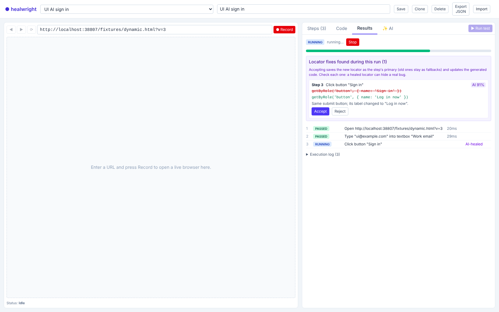
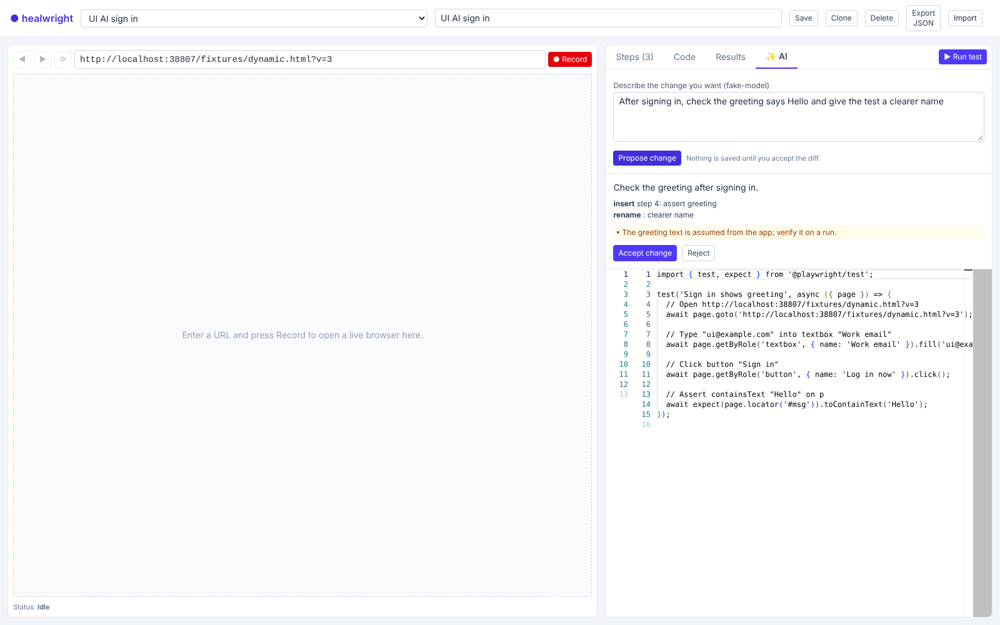

# healwright

healwright is a record-and-play test studio built on Playwright. You open the studio, record real interactions in a live remote Chromium, review and edit the captured steps, read the generated Playwright test, and replay it with step-by-step results. Optional Claude integration heals broken locators during replay and edits tests from plain-English instructions, always behind a reviewable diff.

> Proof of concept: see the known limitations in [docs/ARCHITECTURE.md](docs/ARCHITECTURE.md).

**Highlights**
- Real browser recording: input is forwarded to a remote Chromium, and each step stores ranked locators (test id → role → label → placeholder → text → CSS → XPath), verified by Playwright at record time.
- Engine-neutral action model, with a Playwright code generator and a replay engine (fallback locators, screenshots, per-step logs, replay from any step).
- AI self-healing and prompt-driven editing with Claude (optional, needs an API key).
- 38 automated tests across 20 recording/replay scenarios, generated-spec runs, UI end-to-end and AI flows.


- **Feature status, architecture, sequence diagram, roadmap, limitations:** [docs/ARCHITECTURE.md](docs/ARCHITECTURE.md)
- **Measured results from the last test run:** [docs/TEST_RESULTS.md](docs/TEST_RESULTS.md)
- **PostgreSQL schema (target design):** [docs/schema.sql](docs/schema.sql)

## Quick start

Requires Node.js 22+.

```bash
npm install
npx playwright install chromium   # skip if Chromium for playwright 1.63 is already installed
npm run build                     # builds the studio UI into web/dist
npm start                         # http://localhost:3000
```

Open http://localhost:3000. The URL box defaults to the bundled demo site (`/fixtures/login.html`, user `test-user` / password `s3cret!`); any public URL also works. Then:

1. Press **● Record**. A Chromium session opens in the live view.
2. Click and type in the live view. Steps appear on the right as you go.
3. Press **✔ Add assertion** and click an element to check visibility, text, value, and so on.
4. Press **■ Stop**. The test is saved.
5. Open **Code** to see, copy or download the Playwright spec.
6. Press **▶ Run test**. Results show each step's status, duration, screenshot, any healed locator, and logs.

Hover a step to edit, delete, duplicate, reorder, disable, add an assertion on its element, replay that step, or replay from it.

### AI self-healing and prompt editing (Claude)

Set `ANTHROPIC_API_KEY` before `npm start` to turn on two features. Without a key both are off and the rest of the studio works as before.

- **Self-healing.** When every recorded locator for a step fails during a run, the studio sends Claude a snapshot of the page's interactive elements plus what was recorded about the element (role, name, text, old locators). If Claude picks an element with at least 70% confidence, the studio builds fresh locators for it, checks they match exactly that one element, and carries on. The Results panel then lists the fix (old vs new locator, confidence, reasoning) with **Accept** / **Reject** / **Accept all**. Accepting rewrites the step's locators and the generated code. Run settings → *AI self-healing* switches between *suggest* (default), *auto* (save fixes without review) and *off*.
- **Prompt editing.** Open the **✨ AI** tab, describe the change ("use a variable for the username, drop the Remember me step, check the heading says Welcome"), and press **Propose change**. Claude returns step operations; the studio validates them and shows a code diff. Nothing is saved until you press **Accept change**. If you are recording, Claude also sees the elements on the live page.




For development with hot reload: `npm run dev` (API on :3000, UI on :5173).

### Configuration

| Env var | Default | Purpose |
|---|---|---|
| `PORT` | 3000 | HTTP and WebSocket port |
| `DATA_DIR` | `./data` | Tests, executions, screenshots, uploads |
| `STUDIO_TOKEN` | unset | If set, the API and WebSocket require `Authorization: Bearer <token>` (UI: `?token=`) |
| `HEADED` | unset | Run Chromium headed (local debugging) |
| `TEST_*` | | Secret values for replay after a server restart (for example `TEST_PASSWORD`) |
| `ANTHROPIC_API_KEY` | unset | Enables AI self-healing and prompt editing with Claude |
| `AI_MODEL` | `claude-opus-5-5` | Claude model used for both features |
| `AI_ENABLED` | auto | `false` turns AI off even when a key is set |
| `AI_HEAL_MIN_CONFIDENCE` | `0.7` | Minimum model confidence for an AI heal to be used |

### Docker

```bash
docker compose up --build
```

The image is based on `mcr.microsoft.com/playwright:v1.63.0-noble`. It has not been built in the environment where this PoC was developed. See the limitations in docs/ARCHITECTURE.md.

## Tests

```bash
npm test          # 38 tests: 20 recording/replay scenarios, generated specs run by Playwright Test, UI end-to-end,
                  # codegen units, 11 AI healing/editing tests and an AI UI end-to-end (scripted model),
                  # plus 2 live-Claude tests that are skipped unless ANTHROPIC_API_KEY is set
npm run metrics   # writes docs/TEST_RESULTS.md from the last run
npm run typecheck
```

Every scenario records with real browser input, asserts the exact recorded step sequence, replays the model in a fresh context, and asserts that no step needed a fallback locator. The only exception is the self-healing scenario, which breaks the app on purpose. The generated `.spec.ts` files are then run with `npx playwright test`.

## Layout

```
src/model/actions.ts          normalized action model (engine-neutral)
src/recorder/injected.js      in-page recorder: events, roles/names, selector candidates
src/recorder/RecorderSession  context, binding, merge rules, signals, screencast, input
src/selectors/locator.ts      SelectorCandidate -> Locator and -> source code
src/codegen/playwright.ts     model -> @playwright/test spec
src/replay/ReplayEngine.ts    model -> execution with fallback locators and step results
src/store/Store.ts            persistence port + JSON adapter
src/ai/claude.ts              Claude client (structured outputs), prompts, env config
src/ai/heal.ts                page snapshot, AI element choice, locator rebuild and verification
src/ai/edit.ts                prompt edits: operation validation, apply, diff; heal-proposal apply
src/server/index.ts           REST + WebSocket API
web/                          React studio (Vite, Tailwind, Monaco)
fixtures/site/                demo pages used by the tests
tests/                        scenario, UI, codegen tests
```
