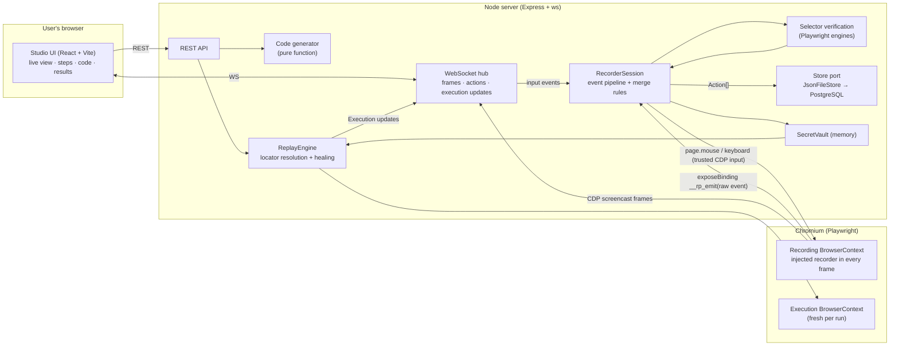

# healwright: features, architecture and roadmap

This document describes what the studio does today, how it is built, and what comes next.

## 1. Feature status

- **Done**: covered by an automated test in `tests/`.
- **Partial**: works, with a stated limit.
- **Not built**: not implemented yet.

### Recording experience

| Capability | Status | Notes |
|---|---|---|
| Starting and stopping a recording | Done | Web UI with Record, Pause, Resume and Stop buttons, plus a URL bar. |
| Where the recorded browser runs | Done | Remote Chromium in its own BrowserContext. The UI streams it over a CDP screencast and forwards mouse and keyboard input. |
| Pause and resume | Done | |
| Navigation events | Done | Typed URLs, back, forward, reload, popups and tab switches are recorded. Navigations caused by a click become a signal on that click, not a separate step. |
| Dynamic elements and SPAs | Done | Every locator is resolved with polling and Playwright auto-waiting. No fixed sleeps are generated. Scenarios 08 and 09 cover this. |
| Selector generation | Done | Selectors are ranked: test id > role+name > label > placeholder > alt > text > CSS > XPath. Each one is scored and checked for uniqueness, then re-checked with Playwright's own engine at record time. |
| Screenshots while recording | Done | One thumbnail per step, taken about 400 ms after the step. |
| Sensitive data | Done | Passwords, OTPs and card numbers are never stored, logged or exported. Their values stay in an in-memory vault only, and exported code reads them from `process.env.TEST_*`. |

### Supported actions

| Action | Status | Notes |
|---|---|---|
| Click | Done | Clicks on child elements are mapped to the interactive element (for example `<span>` inside `<button>`). |
| Double click | Done | The browser's own `dblclick` event is used, and the two preceding clicks are removed. |
| Right click | Done |  |
| Text input | Done | Keystrokes are merged into one `fill` step. A click that only focused the field is dropped. |
| Clear input | Done | Recorded when a field is emptied. |
| Dropdown | Done | Headless screencasts cannot show native `<select>` popups, so the studio shows its own options overlay. Scenario 04 covers this. |
| Checkbox and radio | Done | Recorded from `change` events, so clicks on labels and clicks on inputs give the same step. |
| Keyboard input | Done | Enter, Tab, Escape, arrow keys, function keys and so on. |
| Keyboard shortcuts | Done | For example `Control+k` (scenario 19). |
| Hover | **Not built** | The model, code generator and replay support `hover`, but nothing records it automatically yet. This is the main functional gap. |
| Scroll | Done | Recorded only when the user really scrolled (wheel, touch or scroll keys). Programmatic scrolls are ignored. |
| Drag and drop | Partial | Element to element works, both HTML5 and pointer-based. Offset drops are not built. |
| File upload | Done | The file chooser is intercepted, the user picks a file in the studio, and it is stored in a sandboxed upload folder. Multiple files work too. |
| Navigation | Done |  |
| Back and forward | Done |  |
| Tabs and popups | Done | Popups get page aliases (`page1`, …). Codegen emits `waitForEvent('popup')`. |
| Iframes | Done | The full frame chain is recorded and becomes `.contentFrame()` chains. Nested frames are in the design but not tested. |
| Shadow DOM | Done | Open shadow roots only. Closed shadow roots cannot be reached. |
| Alerts and confirms | Done | Accepted automatically while recording and stored as a signal on the step that caused them. Prompts are accepted with their default value. |
| Rich-text editors | Partial | `contenteditable` input is recorded as `fill(innerText)`. Formatting is lost. |
| Canvas | Not built |  |
| Wait conditions | Done | Manual steps: wait for timeout, load state, URL, or element visible/hidden. |

### Assertions

| Assertion | Status |
|---|---|
| Element present or visible | Done (visible, hidden, count) |
| Text | Done (containsText, hasText, regex, negate) |
| Visual (screenshot against a baseline) | **Not built** (roadmap P2) |
| Extract value (into a variable) | Not built |
| URL and title | Done |
| Enabled, disabled, checked, value, attribute | Done |
| Adding assertions while recording | Done. Picker mode: click an element in the live view, then choose the assertion. |

### Step editing

| Capability | Status |
|---|---|
| Displaying steps | Done |
| Renaming and editing steps | Done (name, value, key, URL, locator choice or custom locator, timeout, optional) |
| Delete, duplicate, reorder, disable | Done (buttons and drag-to-reorder) |
| Replaying one step, or from a step | Done (scenario 20) |
| Variables and test data | Partial: `${name}` variables with env overrides; no generator functions |

### Execution

| Capability | Status |
|---|---|
| Progress and step status | Done (live over WebSocket) |
| Screenshots | Screenshots per step, and a full PNG on failure. No video. |
| Logs | Console errors, page errors and failed requests, with secrets masked |
| Retries and timeouts | Done (per-step retries, timeouts, continue on failure) |
| Self-healing | Done: ranked fallback locators, then an optional Claude stage with reasoning and reviewable fixes (section 8) |
| Cross-browser and real devices | Chromium only (roadmap P2) |
| Scheduling | Not built |
| Exporting code | Done: standalone `@playwright/test` spec, type-checked and run in tests |

## 2. System architecture



Key decisions:

1. **Our own event model, not Playwright codegen.** The injected recorder emits raw, structured events. `RecorderSession` turns them into the engine-neutral `Action` model (`src/model/actions.ts`). Code generation and replay are separate consumers of that model, so neither depends on the other, and either can be replaced (for example by a Selenium generator).
2. **A remote browser with forwarded input, not a browser extension.** It works from any browser, and the input arrives as *trusted* CDP events, so the recorder can ignore every synthetic event (`isTrusted === false`). That includes events from the recording machinery itself.
3. **The replay engine executes the model, not the generated code.** That is what makes per-step status, fallback locators, single-step replay and replay-from-step possible. The generated spec is still checked separately with the real Playwright Test runner, so both paths are known to work.
4. **Selectors are generated in the page, then checked by Playwright.** The browser side has the DOM context to build semantic candidates. Playwright then re-checks each candidate with its own engines before the page changes. A primary that Playwright does not resolve uniquely is demoted. This step caught real gaps between our accessible-name logic and Playwright's while the PoC was being built (for example, listitems have no name from content).
5. **Ports and adapters for persistence.** The PoC uses a JSON file store, and `docs/schema.sql` is the PostgreSQL target. Both sit behind `Store`.

## 3. Component design

| Component | File | Responsibility |
|---|---|---|
| Action model | `src/model/actions.ts` | TypeScript types for 21 action types, targets, selector candidates, frame hops, signals, assertions, executions. No dependencies; the UI imports it as well. |
| Injected recorder | `src/recorder/injected.js` | Capture-phase listeners for click, dblclick, contextmenu, input, change, keydown, scroll, drag, pointer and mousedown events. Maps targets to the meaningful element, computes role and accessible name, generates ranked candidates (with uniqueness counts, `hasText` scoping and `nth` fallback), detects sensitive fields, and runs the assertion picker overlay. |
| RecorderSession | `src/recorder/RecorderSession.ts` | Owns the context. Runs a serialized event queue (keeps order), resolves iframe chains via `frame.frameElement()`, verifies selectors, applies merge rules (fill coalescing, focus-click removal, dblclick, scroll), attributes popups, dialogs, downloads and navigations to the causing step, streams the screencast, forwards input, and handles file choosers and select overlays. |
| SecretVault | `src/recorder/secrets.ts` | In-memory secret store, `TEST_*` variable naming, and log masking. |
| Locator bridge | `src/selectors/locator.ts` | One switch statement turns a `SelectorCandidate` into both a live Locator and its source code, so replay and export cannot drift apart. |
| Code generator | `src/codegen/playwright.ts` | Pure function from model to spec. Hoists reused locators, handles test data via env, secrets, popup/dialog/download waits and every assertion kind. |
| ReplayEngine | `src/replay/ReplayEngine.ts` | Fresh context per run (or the live session for "replay step"). Resolves locators by polling, with a 2-second primary-only grace period before fallbacks are tried. Handles retries, timeouts, navigation sync, screenshots, logs, stop, from-step and only-step. |
| Server | `src/server/index.ts` | REST API, WebSocket hub, concurrency limits, optional bearer token, execution timeout, sandboxed uploads, static UI and fixture site. |
| Studio UI | `web/src/*` | Live browser view, recording controls, steps panel and editor, assertion dialogs, Monaco code panel, results panel, variables, run settings. |

## 4. Recording-to-replay sequence

```mermaid
sequenceDiagram
  actor U as User
  participant UI as Studio UI
  participant S as Server / RecorderSession
  participant B as Chromium page (injected recorder)
  participant P as Playwright engines
  participant R as ReplayEngine
  participant C as Fresh BrowserContext

  U->>UI: Enter URL, press Record
  UI->>S: POST /api/sessions {url}
  S->>B: newContext, exposeBinding(__rp_emit), addInitScript(recorder), goto(url)
  S-->>UI: navigate step (WS "actions")
  S-->>UI: CDP screencast frames (WS "frame")
  U->>UI: click / type on live view
  UI->>S: WS input {mousedown/up, keydown/up}
  S->>B: page.mouse / page.keyboard (trusted input, serialized)
  B->>B: capture-phase listener: isTrusted? map to target, describe, rank selectors
  B->>S: __rp_emit({kind:'click', target, selectors[]})
  S->>P: locator(candidate).count() for each candidate
  P-->>S: counts, so unverified primary is demoted
  S->>S: frame chain, merge rules, attach signals (popup/dialog/nav)
  S-->>UI: WS "actions" (Action[]), thumbnail
  UI->>UI: POST /api/codegen, so live code panel updates
  U->>UI: Add assertion, click element
  S->>B: setMode('assert'): overlay, click is swallowed
  B->>S: pick {target (content-independent selectors), snapshot}
  UI->>S: POST action {type:'assert', ...}
  U->>UI: Stop
  UI->>S: POST /save, POST /stop: TestCase persisted, secrets moved to test vault
  U->>UI: Run test
  UI->>S: POST /api/tests/:id/run
  S->>R: new ReplayEngine(test, options)
  R->>C: newContext()
  loop each step
    R->>C: resolve: primary first (grace), then fallbacks; must match exactly 1
    R->>C: perform action (auto-wait), arm popup/dialog/download listeners
    R->>C: wait for recorded navigation path, settle
    R->>C: screenshot (jpg; png on failure)
    R-->>UI: WS "execution" {step status, duration, healed, error}
  end
  R-->>S: Execution persisted
```

## 5. Database schema

See [`schema.sql`](schema.sql). It covers tenants, projects, suites, test cases, encrypted secrets, recording sessions, recorded actions (jsonb plus promoted columns), executions, execution steps, screenshots (object storage keys) and logs, with row-level security for tenant isolation.

## 6. Prioritized roadmap

| Priority | Item | Why |
|---|---|---|
| P0 ✅ | Event recorder, action model, selector engine with Playwright verification, replay engine, code generator, studio UI | The foundation. Done in this PoC and covered by tests. |
| P1 | Automatic hover recording, plus hover-lock (freeze the page for assertions on menus and tooltips) | Main functional gap |
| P1 | PostgreSQL adapter, auth (OIDC), tenant isolation, encrypted secret storage | Needed for multiple users |
| P1 | Execution workers behind Redis/BullMQ, one container per run, CPU/memory/time limits | Isolation and scale; the PoC runs executions in-process |
| P1 | Step thumbnails as element crops, and video recording of runs | Richer run reports |
| P2 | Visual assertions (`toHaveScreenshot` with baselines), extract-value-to-variable, data-driven runs (CSV) | Missing assertion types |
| P2 | Firefox and WebKit execution (the model and replay are browser-neutral; the recorder's CDP screencast is Chromium-only) | Cross-browser |
| P2 ✅ | AI stage for healing with explanation and one-click "accept healed locator"; prompt-driven test editing with a reviewable diff (section 8) | Reliability, faster maintenance |
| P2 | Attribute-similarity scoring before the AI stage (cheaper, deterministic) | Reliability |
| P3 | Scheduling, suites, CI trigger API, Slack/Jira hooks | Operational features |

## 7. Known limitations (honest list)

- **Hover is not recorded automatically.** You can add a hover step in the code or model, and replay and export both support it, but the recorder does not create one.
- **One server process.** Executions run in-process with a concurrency cap (two by default). There are no separate Docker workers yet. The Dockerfile packages the whole app as one container, and it **has not been built in this environment** (no Docker daemon was available).
- **Persistence is a JSON file.** The PostgreSQL schema is designed but not implemented.
- **Secrets survive only as long as the server.** After a restart, replays need `TEST_*` environment variables. This trade-off is intentional.
- **No real authentication.** The optional `STUDIO_TOKEN` bearer token is a placeholder, not user accounts.
- **Accessible names are approximated in the browser.** They are computed with a pragmatic subset of the accname spec. Playwright verification at record time catches mismatches whenever the page has not changed yet. If the step navigates away first, the browser-side ranking is kept without that check.
- **`nth()` locators stay possible.** When nothing unique exists, the last resort is index-based (`nth`) or structural CSS/XPath, and these are flagged in the step editor with their scores.
- **Closed shadow roots and cross-origin iframes behave differently:** closed shadow roots cannot be reached, while cross-origin iframes work because the recorder is injected into every frame.
- **AI features were not run against live Claude in this environment** (no API key was available). Everything around the model call is tested with a scripted model; `tests/ai-live.spec.ts` covers the real API and runs when `ANTHROPIC_API_KEY` is set. Healing adds model latency (typically seconds) to a broken step, and each heal or edit is a paid API call.
- **AI edit proposals live in server memory** and are lost on restart; ask again.
- **Tested only against the local fixture site**, in headless Chromium and in live (headed) windows under Xvfb. Some sites detect automation, use CAPTCHAs, or depend on native popups such as `<select>` (handled by the overlay), date pickers or print dialogs. These have not been exercised.

## 8. AI self-healing and prompt editing

Both features use Claude through the Anthropic SDK (`src/ai/claude.ts`) with structured outputs, so every answer is parsed against a schema before the studio looks at it. `src/ai/types.ts` defines a small `AiModel` interface; the tests use a scripted implementation of it, and anything else (another model, a proxy) can be plugged in the same way.

### Healing flow

1. Replay tries the recorded locators as before: primary first for a grace period, then fallbacks. Each needs exactly one match.
2. If none is unique by the step deadline and healing is not `off`, `AiHealer` snapshots the step's frame: up to 250 visible, interactive or labelled elements, including open shadow DOM, each tagged with a one-off `data-rp-ai` id. Password values are never included.
3. Claude gets the step description, what was recorded about the element, the old locators, the failure and the snapshot. It answers `{elementIndex, confidence, reasoning}` and is told to answer -1 rather than guess.
4. Below `AI_HEAL_MIN_CONFIDENCE` (0.7) or -1, the step fails as before, with the model's reasoning in the step log.
5. Otherwise the in-page selector ranker builds new candidates for the chosen element. Each is checked with Playwright to match exactly one element **and the same node** Claude chose. The step runs with the best one and is marked *AI-healed*.
6. A `HealProposal` is attached to the execution: new locators first, then the old ones (kept as fallbacks, noted "failed during replay"). Rule-based fallback heals produce proposals too.
7. In `suggest` mode the user accepts or rejects in the Results panel. In `auto` mode the server applies the proposals after the run. Accepting rewrites the step's selectors, which also changes the generated code.

### Prompt editing flow

1. The UI saves the test, then sends the instruction. With a live recording, a snapshot of the current page goes too, so Claude can target elements that are not in the test yet.
2. Claude sees the steps in compact form (no ids, timestamps or screenshots; top three locators) and the generated code, and returns a summary, notes and a list of operations: `update`, `insert`, `delete`, `move`, `setVariable`, `rename`.
3. Each operation is applied to a copy and validated against a zod schema of the action model. Invalid operations are kept with their error and block **Accept**. Element locators written by the model are marked unverified. Secret (password) steps cannot have their value edited.
4. The studio shows the summary, each operation and a diff of the generated code. Nothing is stored until **Accept**; accepting is refused if the test changed since the proposal was made.

### Safety notes

- Page text and test content reach the model as data inside delimited blocks, and the prompts tell it to treat them as untrusted. The model can only return the fixed schemas; it never runs code or touches the page itself.
- Secrets stay out: recorded secret values are never in the action model, and password field values are excluded from snapshots.
- Healing can hide a real regression (the button the test needed may truly be gone, and a look-alike chosen). That is why `suggest` is the default and every heal shows its reasoning.
